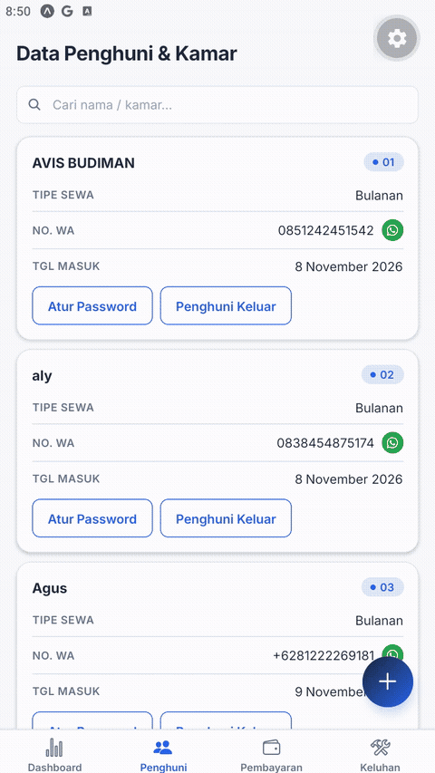
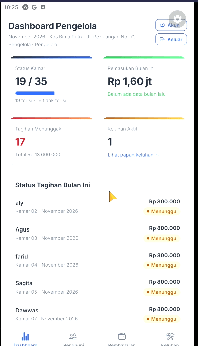
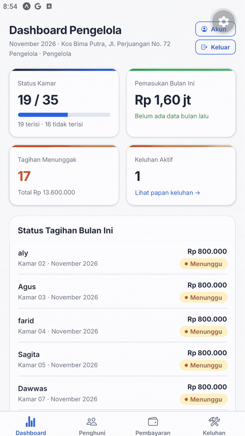
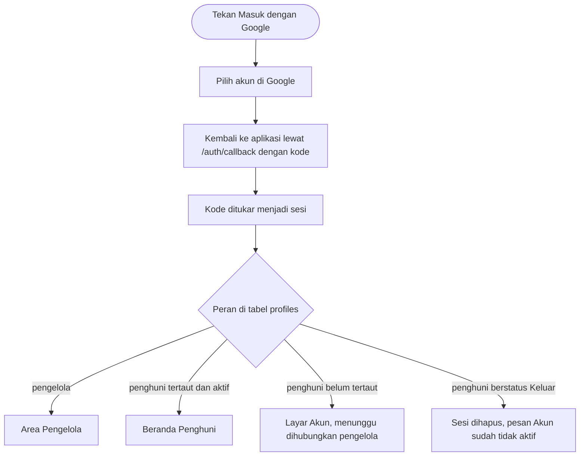
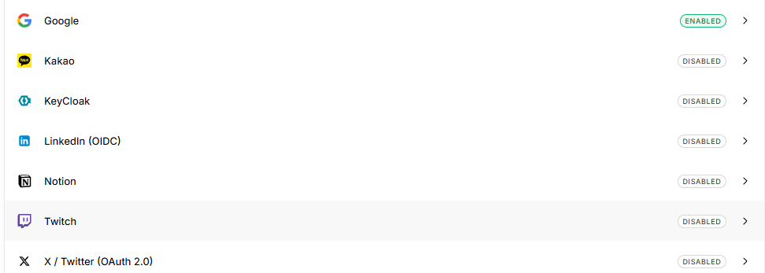
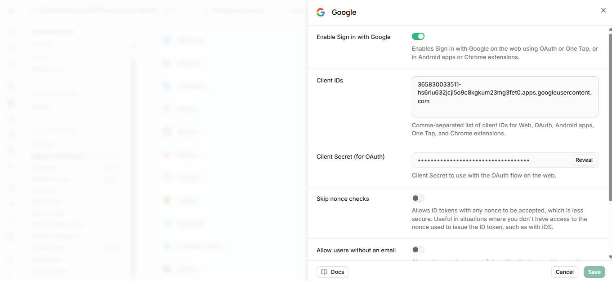
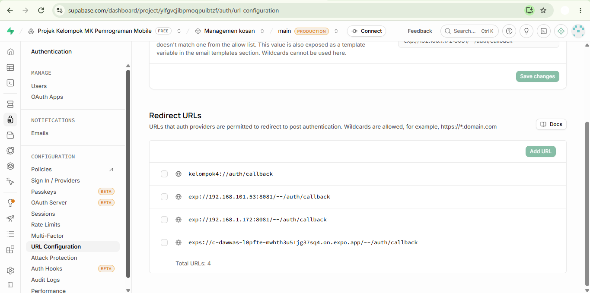

# Laporan Pengembangan — Pemrograman Mobile I
## Revisi CRUD Akun Penghuni & Login dengan Google
### Studi Kasus: Kos Bima Putra — Aplikasi Manajemen Kos Berbasis Peran

---

### Identitas Proyek & Praktikum

- **Mata Kuliah:** Pemrograman Mobile I
- **Pertemuan:** 10
- **Dosen Pengampu:** Mohamad Firdaus, M.Kom
- **Tanggal Praktikum:** November 2026
- **Kelompok:** Kelompok 4
- **Pembagian Tugas Anggota Kelompok:**
  1. **Farid:** Login dengan Google — `masukGoogle()`, rute `/auth/callback`, tombol Google pada Login, penentuan tujuan setelah login (`tentukanRute`), dan konfigurasi Google Cloud / Supabase.
  2. **Dhiyaul:** Registrasi dan Akun Pengguna — layar Registrasi (anti akun ganda), layar Akun (Hubungkan Google, ubah password / email / nomor HP).
  3. **Dawwas:** Revisi CRUD Pengelola — tambah penghuni dengan akun login, atur password, hubungkan akun, penghuni keluar, dan Edge Function `kelola-akun`.
  4. **Hanifa:** Pemulihan dan Verifikasi Akun — lupa password lewat email, OTP SMS beserta pembatas percobaan, dan validasi input (`auth-core.ts`).

### Ringkasan Pembagian Tugas (4 Anggota)

| Anggota | Fokus Pekerjaan | Bagian Laporan | Bukti |
|---|---|---|---|
| **Farid** | Login dengan Google, rute `/auth/callback`, `tentukanRute()`, konfigurasi Google Cloud / Supabase | 2.1, 2.2, 2.3 | 2.4 |
| **Dhiyaul** | Registrasi (anti akun ganda), layar Akun, Hubungkan Google, akun belum tertaut | 2.1 | 2.5 |
| **Dawwas** | Revisi CRUD Pengelola dan Edge Function `kelola-akun` | 1.1, 1.2 | 1.3 |
| **Hanifa** | Lupa password, OTP SMS, pembatas percobaan, validasi input (`auth-core.ts`) | 2.1 | 2.6 |

---

## 1. Revisi: melengkapi CRUD 

### 1.1 Yang Ditambahkan

Pengelola sekarang dapat mengelola akun login penghuni langsung dari layar **Data Penghuni**.

| Fitur | Keterangan | Oleh |
|---|---|---|
| Tambah penghuni + akun login | Form diisi nama, nomor kamar, tipe sewa, nomor HP, tanggal masuk, dan **password awal (min. 8 karakter)**. Data disimpan ke tabel `penghuni`, lalu akun login dibuat otomatis dari nomor HP. Kamar yang tidak ada atau sudah terisi ditolak. | Dawwas |
| Atur Password | Pengelola mengatur ulang password penghuni yang sudah punya akun. | Dawwas |
| Akun lama ditemukan | Bila nomor HP sudah punya akun dari masa tinggal sebelumnya, muncul pop-up konfirmasi **Aktifkan kembali**. Riwayat lama tidak ditimpa. | Dawwas |
| Hubungkan Akun | Untuk penghuni yang belum punya akun, pengelola **memilih manual** akun yang sudah mendaftar sendiri (email / Google). Tersedia pencarian nama, email, atau nomor HP. | Dawwas |
| Penghuni Keluar | Status menjadi `Keluar` dan akun diblokir. Data pembayaran dan keluhan tetap utuh (*soft delete*). | Dawwas |

### 1.2 Edge Function `kelola-akun` *(Dawwas)*

Membuat dan memblokir akun membutuhkan hak admin, sehingga dijalankan di server lewat Edge Function `kelola-akun` (`supabase/functions/kelola-akun/index.ts`). Kunci `service_role` hanya ada di server, tidak pernah di aplikasi.

- Pemanggil harus login (401 bila tidak) dan berperan **pengelola** (403 bila bukan).
- Aksi: `set_password` (buat akun / atur ulang / aktifkan kembali), `hubungkan`, dan `keluar`.
- **Akun tidak pernah ditautkan otomatis** dari kesamaan nama atau nomor HP. Setiap penautan terjadi karena pengelola menyebut penghuni dan akun yang dimaksud secara eksplisit, sehingga akun orang lain tidak bisa tertaut ke data yang salah.
- Bila penautan gagal setelah akun dibuat, akun tersebut dihapus agar tidak ada akun yatim.

### 1.3 Bukti Revisi (*Dawwas*)

**Tambah penghuni + akun login, lalu login dengan akun tersebut**

**Atur password dan konfirmasi akun lama**

**Hubungkan akun terdaftar ke penghuni**

**Penghuni keluar dan akun diblokir**

---

## 2. Login dengan Google

### 2.1 Yang Ditambahkan

Tombol **Masuk dengan Google** ditambahkan pada layar Login dan Registrasi, melengkapi login email dan nomor HP yang sudah ada.

| Bagian | Keterangan | Oleh |
|---|---|---|
| `masukGoogle()` (`src/lib/auth.ts`) | Memanggil `signInWithOAuth` (provider Google), membuka jendela pemilihan akun, lalu menukar kode yang kembali menjadi sesi (alur **PKCE**). Pemilihan akun selalu ditampilkan. | Farid |
| `src/app/auth/callback.tsx` | Rute tujuan kembali dari Google. Kode login hanya ditukar satu kali. Rute yang sama juga menangani verifikasi email dan reset password. | Farid |
| `tentukanRute()` | Setelah login, **peran dibaca dari tabel `profiles`**, bukan dari input pengguna, lalu pengguna diarahkan ke area yang sesuai. | Farid |
| Sesi tersimpan | Klien Supabase memakai `AsyncStorage` dan `flowType: 'pkce'`, sehingga pengguna tetap masuk setelah aplikasi dibuka kembali. | Farid |
| Akun belum tertaut | Akun baru (Google / email) yang belum dihubungkan ke data penghuni diarahkan ke layar **Akun** sampai pengelola menghubungkannya (lihat 1.1). | Dhiyaul |
| `hubungkanGoogle()` (layar Akun) | Menambahkan Google ke akun yang sedang login (`linkIdentity`), tanpa membuat akun kedua. | Dhiyaul |
| Pencegahan akun ganda | Mendaftar dengan email yang sudah dipakai Google ditolak dengan pesan jelas. | Dhiyaul |
| Lupa password dan OTP SMS | Reset password lewat email, serta login OTP dengan jeda kirim ulang dan pembatas percobaan salah. | Hanifa |

Pendukung lain pada pembaruan yang sama: registrasi email, dan edit password / email / nomor HP pada layar Akun (*Dhiyaul*); validasi input pada `auth-core.ts` (*Hanifa*).

### 2.2 Alur Login

### 2.3 Konfigurasi

> Cocokkan dengan pengaturan project kelompok sebelum dikumpulkan.

| Lokasi | Pengaturan |
|---|---|
| Google Cloud Console | OAuth Client tipe **Web**; Authorized redirect URI = `https://<project>.supabase.co/auth/v1/callback` |
| Supabase → Authentication → Providers → Google | Aktifkan; isi Client ID dan Client Secret (secret tidak disimpan di aplikasi maupun repo) |
| Supabase → URL Configuration → Redirect URLs | `kelompok4://auth/callback` dan `exp://**` (Expo Go) |
| Supabase → Authentication | Aktifkan **Allow manual linking** (untuk Hubungkan Google) |
| `app.json` | `"scheme": "kelompok4"` |

### 2.4 Bukti Login Google (*Farid*)

**Provider Google dan Redirect URLs di dashboard Supabase** *(sembunyikan Client Secret)*

**Login dengan Google hingga masuk aplikasi**

**Akun Google tercatat di Authentication → Users**

### 2.5 Bukti Registrasi dan Akun Pengguna (*Dhiyaul*)

**Registrasi email, dan email yang sudah dipakai Google ditolak**

**Akun baru belum tertaut, dihubungkan pengelola, lalu login kembali**

**Hubungkan Google dan ubah password dari layar Akun**

### 2.6 Bukti Lupa Password dan OTP (*Hanifa*)

**Lupa password: tautan email membuka form password baru**

**Login OTP Email dan penguncian setelah kode salah berulang**

Otp sudah bisa di jalankan dalam aplikasi namun memerlukkan biaya per sms otp yang menjadi bloker

---

## 3. Catatan dan Keterbatasan

- Akun yang mendaftar sendiri (email atau Google) **belum dapat dipakai** sampai pengelola menghubungkannya ke data penghuni. Ini disengaja agar akun tidak tertaut ke penghuni yang salah.
- Di **Expo Go**, alamat callback berbentuk `exp://…` dan berubah bila alamat IP laptop berubah; URL ini harus terdaftar di Redirect URLs Supabase.
- Operasi *Delete* tidak tersedia dari antarmuka. Penghuni yang keluar ditandai `Keluar` agar riwayat tidak hilang.

---

## 4. Kesimpulan

Pada pembaruan ini, pengelola dapat menambah penghuni sekaligus akun login, mengatur ulang password, menghubungkan akun yang sudah terdaftar secara manual, dan menandai penghuni keluar dengan memblokir akunnya, seluruhnya lewat Edge Function sehingga `service_role` key tidak berada di aplikasi. Pengguna juga dapat masuk dengan Google melalui Supabase OAuth, dengan peran selalu dibaca dari tabel `profiles` dan akun baru dihubungkan oleh pengelola sebelum dapat mengakses data penghuni.
