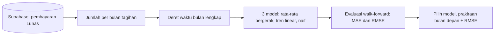
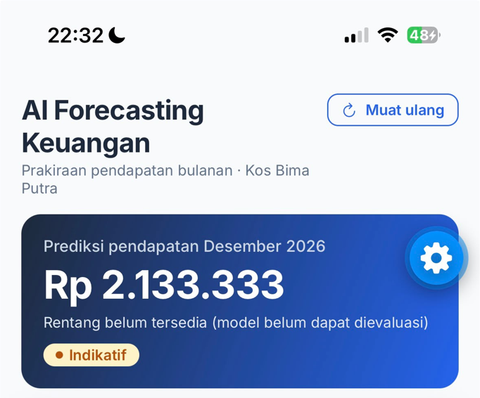
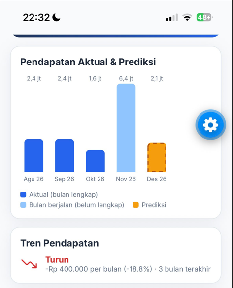
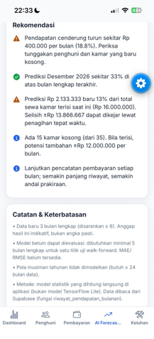
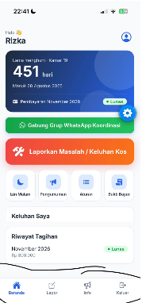
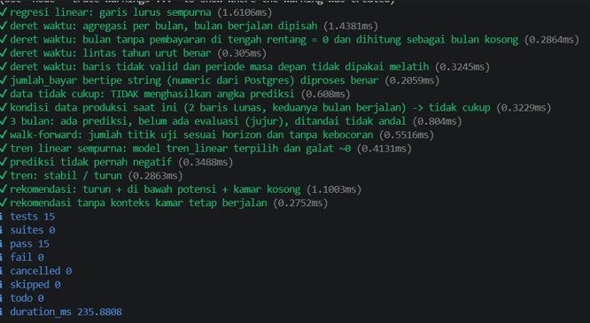
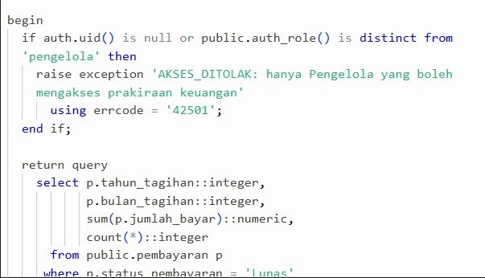

# Laporan Praktikum — Fitur AI Prakiraan Pendapatan (Kos Bima Putra)

**Mata kuliah:** Pemrograman Mobile I · **Pertemuan:** 11
**Kelompok:** 4 · **Proyek:** Kos Bima Putra (Expo SDK 58 + Expo Router + Supabase)
**Repositori:** https://github.com/Rith32-ig/Manajemen-KosBimaPutra
**Modul acuan:** Modul Praktikum – Fitur AI Forecasting (disesuaikan dengan data bulanan)

<!-- sesuaikan pembagian dengan pengerjaan yang sebenarnya -->
| Anggota | Peran |
|---|---|
| Farid | Mesin prakiraan (`forecasting.ts`): deret waktu, model, evaluasi walk-forward |
| Dhiyaul | Pengambilan data asli dari Supabase (`forecast-data.ts`) dan fungsi database `riwayat_pendapatan_bulanan()` |
| Dawwas | Layar Prediksi (`ForecastScreen.tsx`): grafik, tren, evaluasi, rekomendasi |
| Hanifa | Integrasi dan pengujian: tab Prediksi, tautan Dashboard, penghapusan peran pemilik, 15 unit test |

> **Jenis data: ASLI.** Prakiraan dihitung dari tabel `pembayaran` (status Lunas) di Supabase, bukan data sintetis atau data dummy.

## 1. Yang Dibuat

Pengelola mendapat tab baru **Prediksi** yang memperkirakan **pendapatan kos bulan depan** dari riwayat pembayaran nyata, lengkap dengan grafik, tren, evaluasi akurasi, dan rekomendasi.

| Bagian | File | Fungsi |
|---|---|---|
| Mesin prakiraan | `src/lib/forecasting.ts` | Menyusun deret waktu per bulan, menjalankan 3 model, memilih yang terbaik, menghitung tren dan rekomendasi |
| Data asli | `src/lib/forecast-data.ts` | Membaca pendapatan bulanan dari Supabase dan memastikan hanya pengelola yang boleh mengakses |
| Fungsi database | `supabase/migrations/20261121090000_forecasting_pendapatan.sql` | `riwayat_pendapatan_bulanan()` menjumlah pembayaran Lunas per bulan, hanya untuk pengelola |
| Layar | `src/screens/pengelola/ForecastScreen.tsx` | Menampilkan hasil prakiraan |
| Navigasi | `RootNavigator.tsx`, `AdminDashboardScreen.tsx` | Tab **Prediksi** dan tautan "Lihat prediksi AI" di Dashboard |
| Pengujian | `tests/forecasting.test.mjs` | 15 unit test untuk mesin prakiraan |

Pada pembaruan yang sama, peran **pemilik** dihapus sehingga aplikasi hanya punya dua peran: **Pengelola** dan **Penghuni** (`20261121091000_hapus_role_pemilik.sql`).

## 2. Cara Kerja

- **Bulan berjalan tidak dipakai melatih** karena belum lengkap; prakiraan adalah untuk bulan setelahnya.
- **Pemilihan model otomatis** (RMSE terkecil) hanya dilakukan bila semua model punya minimal 2 titik uji, yaitu sekitar 6 bulan data lengkap. Sebelum itu aplikasi memakai **rata-rata bergerak** sebagai model bawaan.

| Bulan lengkap | Yang ditampilkan |
|---|---|
| Kurang dari 3 | "Data belum mencukupi", **tanpa angka** |
| 3–4 | Prakiraan (rata-rata bergerak) berlabel **indikatif**; MAE/RMSE belum bisa dihitung |
| 5 | Prakiraan + MAE/RMSE + rentang ±RMSE dari **1 titik uji** (masih indikatif, model bawaan) |
| 6 atau lebih | Model dipilih otomatis berdasarkan RMSE; hasil dianggap cukup andal |

**Layar Prediksi** (tab *Prediksi*, judul *AI Forecasting*) memuat: bulan berjalan (belum lengkap), riwayat bulan lengkap, grafik pendapatan aktual vs prediksi, tren pendapatan (naik / stabil / turun), evaluasi model (perbandingan RMSE), rekomendasi, serta catatan dan keterbatasan. Rekomendasi dibuat dari aturan yang membandingkan prakiraan dengan tren, total sewa kamar terisi, dan jumlah kamar kosong.

**Keamanan:** fungsi database berjalan dengan hak pemanggil (`security invoker`) sehingga RLS tabel `pembayaran` tetap berlaku, menolak akun selain pengelola (`AKSES_DITOLAK`), dan EXECUTE dicabut dari `anon`. Aplikasi tidak memakai `service_role` key.

**Mengapa TFLite tidak dipakai:** data kos hanya satu titik per bulan, terlalu pendek untuk jaringan saraf (hampir pasti overfit), dan TFLite butuh development build. Model statistik lebih jujur dan dapat dijelaskan. Syarat kapan TFLite layak dipasang dicatat di `README_AI_FORECASTING.md`.

## 3. Dokumentasi Bukti

| Bukti | Berkas |
|---|---|
| GIF: Dashboard → "Lihat prediksi AI" → layar Prediksi |  |
| Tangkapan layar prediksi, grafik, tren, evaluasi, dan rekomendasi |    |
| Penghuni tidak dapat membuka Prediksi (akses ditolak) |   |
| Hasil `npm test` |  |
| Fungsi `riwayat_pendapatan_bulanan` di Supabase |  |

**Hasil unit test** (dijalankan pada kode proyek, `node --test tests/forecasting.test.mjs`): **15 tes, 15 lolos, 0 gagal.**

**Data yang dipakai:**
- **Sumber:** tabel `pembayaran` di Supabase, hanya yang berstatus Lunas (data asli).
- **Bulan lengkap yang dipakai:** 3 bulan, yaitu Agustus 2026 (Rp 2,4 jt), September 2026 (Rp 2,4 jt), dan Oktober 2026 (Rp 1,6 jt).
- **Bulan berjalan:** November 2026 (Rp 6,4 jt tercatat sejauh ini) tidak dipakai melatih karena belum lengkap.
- **Catatan:** bulan tanpa pembayaran Lunas dihitung Rp 0.
- **Kondisi kamar:** 35 kamar, 15 kosong; total sewa kamar terisi Rp 16.000.000 per bulan.

**Hasil prakiraan:**
- **Bulan yang diprediksi:** Desember 2026
- **Prakiraan pendapatan:** Rp 2.133.333 (rata-rata dari tiga bulan lengkap)
- **Model:** rata-rata bergerak, model bawaan bila data belum cukup untuk evaluasi
- **Status:** Indikatif; data baru 3 bulan lengkap (disarankan ≥ 6)
- **Rentang dan evaluasi (MAE/RMSE):** belum tersedia, karena evaluasi walk-forward membutuhkan minimal 5 bulan lengkap
- **Tren:** turun Rp 400.000 per bulan (−18,8%) pada 3 bulan terakhir
- **Posisi prediksi:** sekitar 33% di atas bulan lengkap terakhir (Oktober), dan baru 13% dari total sewa kamar terisi
- **Rekomendasi sistem:** periksa tunggakan penghuni dan kamar yang baru kosong; 15 kamar kosong berpotensi menambah ±Rp 12.000.000 per bulan bila terisi; lanjutkan pencatatan pembayaran setiap bulan agar prakiraan makin andal

## 4. Catatan dan Batasan

1. **Data masih pendek.** Prakiraan dengan kurang dari 6 bulan ditandai indikatif, dan MAE/RMSE baru muncul setelah data cukup. Akurasinya bertambah seiring bertambahnya bulan.
2. **Pola musiman tidak dimodelkan** (butuh minimal 24 bulan data). Bulan tanpa pembayaran Lunas dihitung Rp 0, dan pembayaran di muka untuk periode mendatang tidak dipakai melatih model.
3. **Hasil adalah perkiraan, bukan jaminan.** Layar menampilkan rentang ±RMSE dan label model yang benar-benar dipakai.
4. **Migrasi database:** fungsi `riwayat_pendapatan_bulanan()` perlu dijalankan di SQL Editor Supabase (urut sesuai nama file). Bila belum, aplikasi memakai jalur cadangan membaca tabel `pembayaran` yang tetap dibatasi RLS.
5. **Tidak dikerjakan:** TFLite (alasan di bagian 2), prediksi keterlambatan per penghuni, dan prediksi musiman.

## 5. Kesimpulan
Fitur ini menambahkan AI forecasting pada aplikasi Kos Bima Putra yang bekerja dari **data pembayaran nyata**: pendapatan bulanan dijumlahkan di database, tiga model dievaluasi dengan walk-forward, dan model dipilih otomatis (rata-rata bergerak sebagai bawaan bila data belum cukup) untuk memperkirakan pendapatan bulan depan. Aplikasi menampilkan "data belum mencukupi" alih-alih angka karangan bila riwayat terlalu pendek, dan akses dibatasi hanya untuk pengelola.
