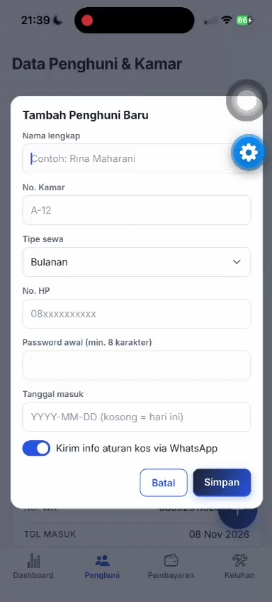

# Laporan Praktikum Pertemuan 9 — Pemrograman Mobile I
## Media Penyimpanan: CRUD dengan Supabase (Database, Auth & Edge Function)
### Studi Kasus: Kos Bima Putra — Aplikasi Manajemen Kos Berbasis Peran (Pemilik, Pengelola, Penghuni)

---

### Identitas Proyek & Praktikum

- **Mata Kuliah:** Pemrograman Mobile I
- **Pertemuan:** 9 (Media Penyimpanan)
- **Dosen Pengampu:** Mohamad Firdaus, M.Kom
- **Tanggal Praktikum:** November 2026
- **Kelas / Kelompok:** [isi kelas] / Kelompok 4
- **Pembagian Tugas Anggota Kelompok:**
  1. **Farid:** Autentikasi & Navigasi — Login Supabase Auth (nomor HP + kata sandi), tabel `profiles`, pemulihan sesi, keluar (logout), klien Supabase terpusat, Landing Page
  2. **Dhiyaul:** Portal Penghuni — Beranda penghuni (data diri, status pembayaran, riwayat tagihan, pengumuman) dan Lapor Keluhan
  3. **Dawwas:** Data Penghuni & Dashboard — CRUD Penghuni, pembuatan akun login penghuni (Edge Function `kelola-akun`), Filter Tipe Sewa, dan Ringkasan Dashboard Pengelola/Pemilik
  4. **Hanifa:** Pembayaran & Keluhan Pengelola — Pencatatan Pembayaran, Kuitansi, Rekap Sudah/Belum Bayar (filter bulan & tahun), Kanban Keluhan, dan Catatan Pengelola

---

## 1. Tujuan dan Capaian Praktikum

Praktikum ini bertujuan memigrasikan data dummy di dalam kode ke backend cloud berbasis **Supabase** (PostgreSQL Database + Auth + Edge Function) pada aplikasi Kos Bima Putra:
1. Membangun project Supabase, skema relasional, serta kebijakan keamanan *Row Level Security* (RLS) berbasis peran.
2. Menghubungkan aplikasi React Native + Expo (TypeScript; Expo Router sebagai entry point dan React Navigation untuk navigasi layar) dengan Supabase lewat klien tunggal terpusat (`@supabase/supabase-js`) dan variabel lingkungan `EXPO_PUBLIC_*`.
3. Memindahkan entitas inti (Kamar, Penghuni, Pembayaran, Keluhan, Pengumuman, dan Catatan Pengelola) ke cloud database sehingga setiap layar membaca dan menulis data nyata.
4. Mengganti akun login dummy dengan **Supabase Auth**; pengguna masuk memakai nomor HP dan kata sandi, sedangkan peran (pemilik/pengelola/penghuni) dibaca dari tabel `profiles`, bukan dari kode aplikasi.
5. Memindahkan operasi yang membutuhkan hak admin (membuat akun penghuni, mengatur ulang kata sandi, memblokir akun penghuni yang keluar) ke **Edge Function** `kelola-akun`, sehingga `service_role` key tidak pernah berada di aplikasi.
6. Menerapkan rekap pembayaran sudah/belum bayar yang dihitung dari data database berdasarkan filter bulan dan tahun.

---

## 2. Arsitektur Basis Data Cloud (Supabase)

Skema terdiri dari tujuh tabel yang seluruhnya dilindungi *Row Level Security* (RLS). Berikut ringkasan tabel yang dipakai aplikasi.

<!-- VERIFIKASI: berkas supabase/schema.sql tidak ikut dalam proyek yang diperiksa. DDL di bawah disusun dari kolom yang benar-benar dipakai kode aplikasi dan dari laporan sebelumnya. Cocokkan dengan schema.sql asli sebelum dikumpulkan. -->

### 2.1 Tabel `profiles` (Modul Autentikasi — Farid)
Satu baris per akun di `auth.users`. Kata sandi tidak disimpan di sini (dikelola Supabase Auth). Aplikasi membaca kolom `id`, `nama`, `role`, dan `nomor_hp`. Peran `pengelola`/`pemilik` hanya dapat diberikan lewat SQL Editor, sehingga tidak ada pengguna yang dapat mengangkat dirinya sendiri.
```sql
create table public.profiles (
  id         uuid primary key references auth.users (id) on delete cascade,
  nama       text not null,
  nomor_hp   text,
  role       text not null default 'penghuni'
             check (role in ('pemilik', 'pengelola', 'penghuni')),
  created_at timestamptz not null default now()
);
```
Login memakai **Phone Auth** Supabase: nomor yang diketik pengguna (misalnya `0882-1177-0908`) dinormalisasi oleh fungsi `keE164()` menjadi format internasional `+6288211770908`, lalu dikirim ke `signInWithPassword({ phone, password })`. Tidak ada SMS yang dikirim karena akun dibuat dengan `phone_confirm: true` oleh Edge Function.

### 2.2 Tabel `kamar` & `penghuni` (Modul Data Penghuni — Dawwas)
Nomor kamar disimpan sebagai teks (`'05'`, `'19'`, ...) sehingga angka nol di depan tidak hilang. Satu kamar hanya boleh dihuni satu penghuni **aktif** (unique index parsial `uq_penghuni_kamar_aktif`). Kolom `nomor_hp` boleh kosong. `profile_id` menghubungkan penghuni dengan akun login dan boleh kosong untuk penghuni yang belum memiliki akun.
```sql
create table public.kamar (
  id           uuid primary key default gen_random_uuid(),
  nomor_kamar  text not null unique,
  tipe_sewa    text not null default 'Bulanan' check (tipe_sewa in ('Bulanan', 'Harian')),
  harga_sewa   numeric(12, 2) not null default 0 check (harga_sewa >= 0),
  status_kamar text not null default 'Kosong' check (status_kamar in ('Kosong', 'Terisi', 'Perbaikan')),
  created_at   timestamptz not null default now()
);

create table public.penghuni (
  id                uuid primary key default gen_random_uuid(),
  profile_id        uuid unique references public.profiles (id) on delete set null,
  nama              text not null check (length(trim(nama)) > 0),
  nomor_kamar       text not null references public.kamar (nomor_kamar)
                    on update cascade on delete restrict,
  nomor_hp          text,
  tipe_sewa         text not null default 'Bulanan' check (tipe_sewa in ('Bulanan', 'Harian')),
  tanggal_masuk     date not null default current_date,
  status_penghuni   text not null default 'Aktif' check (status_penghuni in ('Aktif', 'Keluar')),
  metode_pembayaran text check (metode_pembayaran in ('TF', 'Cash')),
  created_at        timestamptz not null default now()
);
create unique index uq_penghuni_kamar_aktif
  on public.penghuni (nomor_kamar) where status_penghuni = 'Aktif';
```
Status kamar (`Kosong`/`Terisi`) diperbarui otomatis oleh trigger `trg_penghuni_sync_kamar` mengikuti penghuni aktif. Penghuni yang sudah memiliki riwayat pembayaran atau keluhan tidak dihapus (`on delete restrict`); sebagai gantinya aplikasi menyediakan aksi **Penghuni Keluar** (*soft delete*): status menjadi `Keluar`, akun login diblokir, dan riwayat tetap tersimpan.

### 2.3 Tabel `pembayaran` (Modul Pembayaran — Hanifa)
Bulan disimpan sebagai angka 1–12 di database, sedangkan aplikasi memakai indeks 0–11 pada daftar nama bulan (dikonversi saat simpan dan baca). Penghuni dianggap **sudah bayar** pada suatu periode bila memiliki pembayaran berstatus `Lunas` pada bulan dan tahun tersebut. Pembayaran yang dicatat pengelola langsung disimpan dengan status `Lunas`. Riwayat tagihan penghuni dan angka pada dashboard dihitung dari tabel ini; tidak ada tabel `tagihan` terpisah.
```sql
create table public.pembayaran (
  id                uuid primary key default gen_random_uuid(),
  penghuni_id       uuid not null references public.penghuni (id) on delete restrict,
  jumlah_bayar      numeric(12, 2) not null check (jumlah_bayar > 0),
  tanggal_bayar     date not null default current_date,
  bulan_tagihan     smallint not null check (bulan_tagihan between 1 and 12),
  tahun_tagihan     smallint not null check (tahun_tagihan between 2000 and 2100),
  metode_pembayaran text not null default 'Transfer' check (metode_pembayaran in ('Transfer', 'Cash')),
  status_pembayaran text not null default 'Menunggu'
                    check (status_pembayaran in ('Menunggu', 'Lunas', 'Ditolak')),
  bukti_pembayaran  text,
  created_at        timestamptz not null default now()
);
create index idx_pembayaran_periode
  on public.pembayaran (tahun_tagihan, bulan_tagihan, status_pembayaran);
```
Kolom `bukti_pembayaran` disiapkan di skema untuk pengembangan lanjutan (unggah bukti transfer) dan belum dipakai aplikasi pada praktikum ini.

### 2.4 Tabel `keluhan`, `pengumuman` & `catatan_pengelola` (Modul Portal Penghuni — Dhiyaul; Keluhan Pengelola — Hanifa)
Empat nilai `status_penanganan` sama dengan empat kolom papan kanban keluhan (`Masuk`, `Ditangani Mandiri`, `Perlu Teknisi`, `Selesai`).
```sql
create table public.keluhan (
  id                uuid primary key default gen_random_uuid(),
  penghuni_id       uuid not null references public.penghuni (id) on delete restrict,
  kategori          text not null check (kategori in ('Wi-Fi', 'Fasilitas', 'Air', 'Listrik')),
  deskripsi         text not null check (length(trim(deskripsi)) > 0),
  status_penanganan text not null default 'Masuk'
                    check (status_penanganan in ('Masuk', 'Ditangani Mandiri', 'Perlu Teknisi', 'Selesai')),
  prioritas         text not null default 'Sedang' check (prioritas in ('Rendah', 'Sedang', 'Urgent')),
  created_at        timestamptz not null default now(),
  updated_at        timestamptz not null default now()
);

create table public.pengumuman (
  id                 uuid primary key default gen_random_uuid(),
  judul              text not null,
  isi_pengumuman     text not null,
  kategori           text not null default 'Info' check (kategori in ('Penting', 'Info', 'Rutin')),
  tanggal_pengumuman date not null default current_date,
  dibuat_oleh        uuid default auth.uid() references public.profiles (id) on delete set null,
  created_at         timestamptz not null default now()
);

create table public.catatan_pengelola (
  id          uuid primary key default gen_random_uuid(),
  teks        text not null check (length(trim(teks)) > 0),
  selesai     boolean not null default false,
  dibuat_oleh uuid default auth.uid() references public.profiles (id) on delete set null,
  created_at  timestamptz not null default now()
);
```

### 2.5 Row Level Security (RLS) Berbasis Peran
Seluruh tabel memakai RLS yang diaktifkan lebih dulu, lalu policy dibuat hanya untuk role `authenticated`; pengguna anonim ditolak total. Peran pengguna dibaca dari tabel `profiles` lewat fungsi `auth_role()`, dan penghuni dikenali lewat fungsi `my_penghuni_id()` (keduanya `security definer` agar tidak memicu rekursi RLS). Karena itu aplikasi tidak perlu mengirim `penghuni_id` untuk membaca data penghuni: query cukup `select` dan database hanya mengembalikan baris milik akun yang sedang login.

| Tabel | Pemilik | Pengelola | Penghuni |
|---|---|---|---|
| `profiles` | baca semua | baca semua | baca miliknya |
| `kamar` | baca | baca + tulis | baca |
| `penghuni` | baca semua | baca + tulis | baca miliknya |
| `pembayaran` | baca semua | baca, tambah, ubah | baca miliknya |
| `keluhan` | baca semua | baca, tambah, ubah | baca miliknya; tambah milik sendiri (status `Masuk`, prioritas `Sedang`) |
| `pengumuman` | baca | baca + tulis | baca |
| `catatan_pengelola` | baca | baca + tulis | tidak ada akses |

Tidak ada policy tulis pada `profiles`, sehingga peran tidak dapat diubah dari aplikasi.

<!-- VERIFIKASI: sesuaikan tabel di atas dengan policy yang benar-benar dibuat di schema.sql. -->

### 2.6 Edge Function `kelola-akun` (Supabase Functions)
Pembuatan akun login dan pemblokiran akun membutuhkan hak admin Supabase Auth, yang tidak boleh dijalankan dari aplikasi. Karena itu operasi tersebut dijalankan oleh Edge Function `kelola-akun` (`supabase/functions/kelola-akun/index.ts`) yang memakai `SUPABASE_SERVICE_ROLE_KEY` di sisi server. Alur kerjanya:
1. Fungsi memverifikasi token pemanggil, lalu memastikan `profiles.role` pemanggil adalah `pengelola`; selain itu ditolak (HTTP 401/403).
2. Aksi **`set_password`**: bila penghuni sudah punya `profile_id`, kata sandi akun diatur ulang (`updateUserById`); bila belum, akun baru dibuat dengan `createUser({ phone, password, phone_confirm: true })` dari nomor HP penghuni. Kata sandi minimal 8 karakter dan hanya berlaku untuk penghuni berstatus `Aktif`.
3. Aksi **`keluar`**: status penghuni diubah menjadi `Keluar` dan akun auth-nya diblokir (`ban_duration: '876000h'`), sehingga tidak dapat login lagi tetapi riwayat data tetap utuh.

Aplikasi memanggilnya lewat `supabase.functions.invoke('kelola-akun', { body })`.

---

## 3. Implementasi Kode Program Berdasarkan Pembagian Tugas

Aplikasi ditulis dengan TypeScript. Setiap layar mengakses Supabase langsung lewat klien tunggal `src/lib/supabase.ts` (query `select`/`insert`/`update` pada `supabase.from(...)`), tanpa lapisan context terpisah. Header tiap berkas layar diberi penanda anggota pemegang modul.

### 3.1 Klien Supabase Terpusat (`src/lib/supabase.ts`)
Menginisialisasi `createClient` dengan `EXPO_PUBLIC_SUPABASE_URL` dan `EXPO_PUBLIC_SUPABASE_KEY` dari file `.env`, yang tidak diunggah ke repository sehingga kunci tidak ikut ke Git. Hanya *publishable/anon key* yang dipakai; `service_role` key tidak pernah ada di aplikasi. Sesi login disimpan di `AsyncStorage` (`persistSession`, `autoRefreshToken`). Berkas ini juga memuat:
- tipe `Role` dan `Profil`, serta fungsi `ambilProfil()` (membaca `profiles` milik akun login) dan `keluar()` (menghapus profil lokal dan `signOut`);
- `keE164()` untuk normalisasi nomor HP, serta helper tampilan `rupiah()`, `tglPendek()`, `tglPanjang()`, dan daftar `BULAN`;
- pemetaan `TARGET` dari peran ke layar tujuan: `pemilik → PemilikTabs`, `pengelola → AdminTabs`, `penghuni → PenghuniTabs`.

### 3.2 Modul 1: Autentikasi & Navigasi — *Farid*
- **`src/screens/LoginScreen.tsx`**: satu form untuk semua peran (nomor HP + kata sandi) dengan validasi per kolom dan tombol "Memproses…" saat login berjalan. Setelah `signInWithPassword` berhasil, peran dibaca dari `profiles` lewat `ambilProfil()`. Akun tanpa profil langsung dikeluarkan. Untuk penghuni, aplikasi memeriksa tabel `penghuni` berstatus `Aktif` sehingga penghuni yang sudah keluar ditolak. Pesan error dipetakan ke bahasa Indonesia (nomor HP atau password salah, akun tidak aktif, terlalu banyak percobaan, tidak ada koneksi).
- **`src/screens/LandingScreen.tsx`**: halaman awal aplikasi dengan tombol menuju Login.
- **`src/screens/RootNavigator.tsx`**: saat aplikasi dibuka, sesi tersimpan dipulihkan (`getSession`) dan pengguna langsung diarahkan sesuai peran dari database; tanpa sesi, tampil Landing. Terdapat tiga kelompok tab: `AdminTabs` (pengelola), `PemilikTabs` (memakai komponen tab yang sama dalam mode hanya-baca), dan `PenghuniTabs`. Tab "Keluar" memanggil `keluar()` lalu kembali ke Landing.
- **`src/app/index.tsx`**: titik masuk Expo Router yang membungkus `RootNavigator` dengan `NavigationContainer`.

### 3.3 Modul 2: Portal Penghuni — *Dhiyaul*
- **`src/screens/penghuni/PenghuniHomeScreen.tsx`**: membaca nama, kamar, dan tanggal masuk penghuni (ditampilkan sebagai lama menghuni), status pembayaran bulan berjalan (Lunas / Belum bayar), daftar keluhan milik sendiri dengan status kanban, riwayat tagihan dari tabel `pembayaran`, dan pengumuman dari tabel `pengumuman`. Data dimuat ulang setelah keluhan baru dikirim.
- **`src/screens/penghuni/LaporKeluhanScreen.tsx`**: keluhan (kategori + deskripsi) disimpan ke tabel `keluhan` dengan status awal `Masuk` dan prioritas `Sedang`; `penghuni_id` diperoleh dari akun yang login. Bila penghuni tidak ditemukan atau insert gagal, pesan error ditampilkan.

### 3.4 Modul 3: Data Penghuni & Dashboard — *Dawwas*
- **`src/screens/pengelola/DataPenghuniScreen.tsx`**: daftar penghuni aktif dari tabel `penghuni` dengan pencarian dan filter tipe sewa. Pengelola dapat **menambah penghuni** (nama, kamar, tipe sewa, nomor HP, password awal minimal 8 karakter, tanggal masuk `YYYY-MM-DD`): data disimpan ke `penghuni`, lalu akun login dibuat lewat Edge Function. Pesan error database dipetakan (kamar tidak ditemukan; kamar sudah terisi penghuni aktif). Tersedia juga aksi **Atur Password** dan **Penghuni Keluar**. Penghuni tanpa HP menampilkan "-" dan tombol WhatsApp tidak muncul. Pada peran Pemilik, tombol tambah dan aksi ubah disembunyikan.
- **`src/screens/pengelola/AdminDashboardScreen.tsx`**: ringkasan yang dihitung dari database: kamar terisi dari total, pemasukan bulan ini beserta persentase naik/turun dibanding bulan lalu, jumlah dan nilai tagihan menunggak (penghuni aktif yang belum Lunas bulan ini, dikali harga sewa kamar), jumlah keluhan aktif, dan daftar status tagihan bulan ini. Judul dan nama berubah mengikuti peran (Dashboard Pengelola / Dashboard Pemilik).

### 3.5 Modul 4: Pembayaran & Keluhan Pengelola — *Hanifa*
- **`src/screens/pengelola/PembayaranScreen.tsx`**: form pencatatan pembayaran (penghuni, metode, bulan, tahun, nominal; nominal terisi otomatis dari `harga_sewa` kamar) yang disimpan ke tabel `pembayaran` dengan status `Lunas`, pratinjau kuitansi digital, riwayat transaksi dari database, daftar terlambat bayar (penghuni aktif yang belum membayar bulan berjalan), dan Rekap Sudah/Belum Bayar dengan filter bulan dan tahun yang dihitung dari data.
- **`src/screens/pengelola/KeluhanAdminScreen.tsx`**: papan kanban empat kolom dari tabel `keluhan`; memindahkan tiket satu tahap ke kanan menyimpan perubahan ke kolom `status_penanganan`. Catatan pengelola (tambah dan centang selesai) tersimpan di tabel `catatan_pengelola`. Peran Pemilik hanya dapat melihat.

---

## 4. Hasil Uji Coba End-to-End (Checklist Capaian)

> **Petunjuk:** ganti `BELUM DIUJI` dengan **LOLOS** atau **GAGAL** setelah diuji, dan isi kolom hasil sesuai yang benar-benar terjadi. Kode dan SQL belum dijalankan terhadap project Supabase kelompok pada saat laporan ini disusun, sehingga seluruh status di bawah masih `BELUM DIUJI`.

| No | Modul / Kriteria Pengujian | Penanggung Jawab | Status | Hasil Pengujian |
|---|---|---|---|---|
| 1 | Uji koneksi Supabase (`.env` terbaca, aplikasi berjalan tanpa error `supabaseUrl is required`) | Tim | BELUM DIUJI | |
| 2 | Seed 35 kamar dan 12 penghuni di Table Editor | Tim | BELUM DIUJI | |
| 3 | Login pengelola dengan nomor HP via Supabase Auth | Farid | BELUM DIUJI | |
| 4 | Login penghuni dengan nomor HP via Supabase Auth | Farid | BELUM DIUJI | |
| 6 | Login dengan nomor/kata sandi salah menampilkan pesan error | Farid | BELUM DIUJI | |
| 7 | Penghuni berstatus Keluar ditolak saat login | Farid | BELUM DIUJI | |
| 8 | Keluar (logout) kembali ke Landing | Farid | BELUM DIUJI | |
| 9 | Sesi login dipulihkan setelah aplikasi ditutup dan dibuka ulang | Farid | BELUM DIUJI | |
| 10 | Kirim keluhan baru dari Lapor Keluhan | Dhiyaul | BELUM DIUJI | |
| 11 | Keluhan tampil di Beranda penghuni | Dhiyaul | BELUM DIUJI | |
| 12 | Riwayat tagihan dan status bayar bulan ini tampil dari database | Dhiyaul | BELUM DIUJI | |
| 13 | Pengumuman tampil dari database | Dhiyaul | BELUM DIUJI | |
| 14 | Daftar penghuni dari Supabase; HP kosong tampil "-" tanpa tombol WhatsApp | Dawwas | LOLOS | |
| 15 | Tambah penghuni sekaligus membuat akun login (Edge Function) | Dawwas | Lolos | |
| 16 | Tambah penghuni ke kamar yang sudah terisi ditolak | Dawwas | Lolos | sudah berhasil jika kamar terisi maka ditolak |
| 17 | Atur Password penghuni, lalu login dengan password baru | Dawwas | Lolos |berhasil saya sudah nyoba ke penghuni nya |
| 19 | Filter tipe sewa | Dawwas | Lolos |  |
| 20 | Ringkasan Dashboard dari database | Dawwas | Lolos | sudah teruji ada buktinya di c.4 dan c.5 |
| 21 | Catat pembayaran dan buat kuitansi | Hanifa | Lolos ||
| 22 | Rekap sudah/belum bayar dengan filter bulan dan tahun | Hanifa | Lolos  | |
| 23 | Perpindahan tahap keluhan (kanban) tersimpan | Hanifa | Lolos ||
| 24 | Catatan pengelola (tambah dan centang) tersimpan | Hanifa | Lolos ||
| 25 | Keluhan dari penghuni muncul di papan pengelola | Dhiyaul & Hanifa | Lolos ||
| 26 | Penghuni hanya melihat data miliknya (RLS) | Tim | BELUM DIUJI | |
| 27 | Pembuktian RLS (hapus salah satu policy tulis → gagal, kembalikan → berhasil) | Tim | BELUM DIUJI | |
| 28 | Edge Function menolak pemanggil selain pengelola | Tim | BELUM DIUJI | |

### Batasan yang diketahui
- **Izin Pulang Malam** dan **Unggah Bukti Bayar** pada Beranda penghuni masih berupa tampilan: tombol kirim hanya menampilkan notifikasi dan tidak menyimpan ke database maupun Supabase Storage. Kolom `bukti_pembayaran` sudah ada di skema untuk pengembangan lanjutan.
- Kolom "Foto bukti" pada Lapor Keluhan juga hanya tampilan; foto tidak diunggah.
- Operasi *Delete* tidak tersedia dari antarmuka. Penghuni yang keluar ditandai `Keluar` (*soft delete*) agar riwayat pembayaran dan keluhan tidak hilang. Catatan pengelola belum dapat dihapus dari antarmuka, dan layar kelola pengumuman belum ada (pengumuman diisi lewat Table Editor).
- Pembayaran yang dicatat pengelola langsung berstatus `Lunas`; belum ada alur konfirmasi Lunas/Tolak. Pilihan "Tipe sewa" pada form pembayaran belum disimpan ke database.
- Sisa masa sewa tidak ditampilkan karena database tidak menyimpan tanggal berakhir sewa; Beranda penghuni menampilkan lama menghuni sejak tanggal masuk.
- Bila file `.env` tidak ada atau salah nama, aplikasi gagal dimuat dengan pesan `supabaseUrl is required`. File harus bernama persis `.env`, berada sejajar dengan `package.json`, dan Expo dijalankan ulang dengan `npx expo start -c`.
- Data penghuni hasil impor berjumlah 12 baris; Syifa dan Anisa (kamar 26) tersimpan dalam satu baris dengan dua nomor HP. Harga sewa kamar bernilai 0 sampai diisi pengelola, sehingga nominal tagihan pada dashboard tampil Rp 0.

---

## 5. Dokumentasi Bukti Pengerjaan (Screenshot & GIF)

> **Petunjuk Anggota Tim:**
> Simpan file screenshot / GIF di folder `docs/`. Setiap bagian di bawah sengaja dikosongkan; untuk mengisinya, hapus tanda komentar `<!--` dan `-->` pada tag `` yang sesuai dan pastikan nama file cocok dengan atribut `src`.

---

### Bagian A: Bukti Modul Autentikasi & Navigasi (*Farid*)

#### A.1 Bukti Koneksi Aplikasi ke Supabase
<!-- <div align="center"></div> -->

#### A.2 Tabel `profiles` dan Akun di Authentication
<!-- <div align="center"></div> -->

#### A.3 Login Pengelola, Pemilik, dan Penghuni (Satu Form, Nomor HP)
<!-- <div align="center"></div> -->

#### A.4 Keluar (Logout) dan Pemulihan Sesi
<!-- <div align="center"></div> -->

---

### Bagian B: Bukti Modul Portal Penghuni (*Dhiyaul*)

#### B.1 Tabel `keluhan` di Supabase
<!-- <div align="center"></div> -->

#### B.2 Kirim Lapor Keluhan
<!-- <div align="center"></div> -->

#### B.3 Beranda Penghuni (Keluhan, Tagihan, Status Bayar dari Supabase)
<!-- <div align="center"></div> -->

#### B.4 Pengumuman dari Tabel `pengumuman`
<!-- <div align="center"></div> -->

---

### Bagian C: Bukti Modul Data Penghuni & Dashboard (*Dawwas*)

#### C.1 Tabel `kamar` dan `penghuni` di Supabase


#### C.2 Daftar Penghuni (HP Kosong Tampil "-") dan Filter Tipe Sewa


#### C.3 Tambah Penghuni + Akun Login, Atur Password


#### C.4 Edge Function `kelola-akun` di Dashboard Supabase


#### C.5 Dashboard Pengelola


---

### Bagian D: Bukti Modul Pembayaran & Keluhan Pengelola (*Hanifa*)

#### D.1 Tabel `pembayaran` di Supabase


#### D.2 Catat Pembayaran dan Kuitansi


#### D.3 Rekap Sudah/Belum Bayar (Filter Bulan dan Tahun)


#### D.4 Papan Keluhan (Kanban) dan Catatan Pengelola


---

### Bagian E: Bukti Bersama (*Tim*)

#### E.1 Tampilan Pemilik (Hanya-Baca)
<!-- <div align="center"></div> -->

#### E.2 Pembuktian RLS (Hapus Policy → Gagal, Kembalikan → Berhasil)
Dashboard Supabase memakai role `postgres` yang melewati RLS, sehingga pengujian dilakukan dari aplikasi (login sebagai pengelola), bukan dari SQL Editor.
<!-- <div align="center"></div> -->

---

## 6. Kesimpulan

> **Catatan:** sesuaikan kesimpulan ini dengan hasil pengujian yang sebenarnya pada Bagian 4.

Praktikum Pertemuan 9 memigrasikan penyimpanan data aplikasi Kos Bima Putra dari data dummy di dalam kode ke layanan backend cloud **Supabase**, mencakup database PostgreSQL, Auth, dan Edge Function.

Kolaborasi tim Kelompok 4 membagi tanggung jawab ke dalam 4 modul:
1. **Autentikasi & Navigasi:** Dikerjakan oleh **Farid**, mencakup klien Supabase terpusat, login nomor HP dengan Supabase Auth, tabel `profiles` dengan peran dari database, pemulihan sesi, navigasi berbasis peran, dan keluar.
2. **Portal Penghuni:** Dikerjakan oleh **Dhiyaul**, mencakup pengiriman keluhan, daftar keluhan, riwayat tagihan, status pembayaran, dan pengumuman dari database.
3. **Data Penghuni & Dashboard:** Dikerjakan oleh **Dawwas**, mencakup CRUD penghuni, pembuatan akun login lewat Edge Function, filter tipe sewa, penanganan nomor HP kosong, serta ringkasan dashboard.
4. **Pembayaran & Keluhan Pengelola:** Dikerjakan oleh **Hanifa**, mencakup pencatatan pembayaran, kuitansi, rekap sudah/belum bayar per bulan dan tahun, kanban keluhan, dan catatan pengelola.

Seluruh tabel dilindungi Row Level Security berbasis peran (pemilik, pengelola, penghuni), dan operasi berhak admin dijalankan di sisi server lewat Edge Function sehingga `service_role` key tidak berada di aplikasi. Fitur Izin Pulang Malam dan Unggah Bukti Bayar masih berupa tampilan dan belum tersimpan di database maupun Storage.
