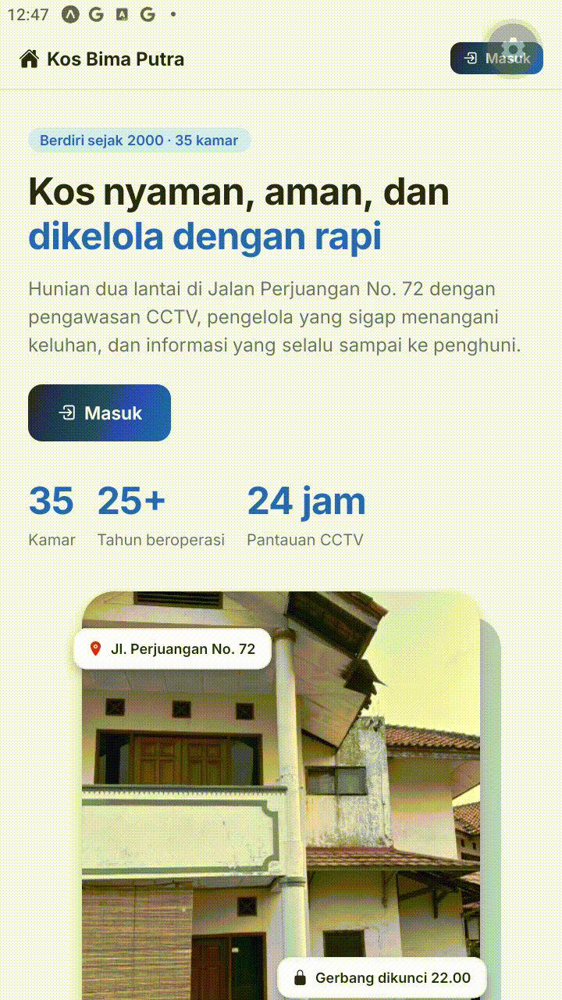
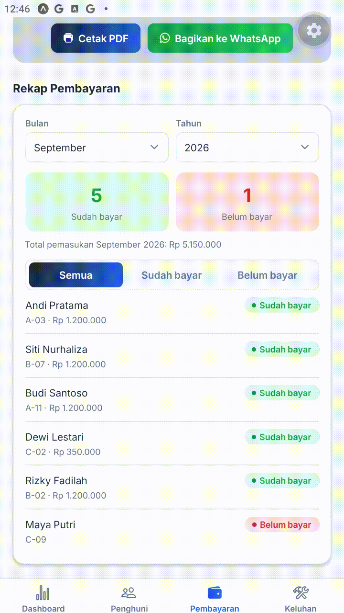

# Perbaikan UTS — Kelompok 4 (Kos Bima Putra)

## Revisi

| No | Revisi dan Masukan | Bobot | Status |
|----|--------------------|-------|--------|
| 1 | Satukan saja untuk form Login Penghuni dan Pengelola | 5 | Selesai |
| 2 | Rekap data Sudah bayar dan Belum bayar, filter bulan dan tahun | 10 | Selesai |

---

## 1. Satukan form Login Penghuni dan Pengelola

**Sebelum**
- Landing memiliki dua tombol terpisah: "Masuk sebagai Penghuni" dan "Masuk sebagai Pengelola".
- Tampilan Login berbeda untuk tiap peran.

**Sesudah**
- Hanya ada satu tombol **Masuk** dan satu form login.
- Peran ditentukan otomatis dari akun yang dimasukkan, lalu pengguna diarahkan ke area Pengelola atau Penghuni.
- Akun dummy: `pengelola / pengelola123` dan `penghuni / penghuni123`.

**File:** `LandingScreen.tsx`, `LoginScreen.tsx`, `RootNavigator.tsx`

**Bukti**

---

## 2. Rekap data Sudah bayar dan Belum bayar (filter bulan dan tahun)

**Sebelum**
- Halaman Pembayaran hanya berisi form catat pembayaran, kuitansi, riwayat, dan daftar terlambat bayar.
- Tidak ada rekap penghuni yang sudah dan belum bayar per bulan.

**Sesudah**
- Ditambahkan bagian **Rekap Pembayaran** dengan filter **Bulan** dan **Tahun**.
- Menampilkan jumlah penghuni **Sudah bayar** dan **Belum bayar**, total pemasukan, serta daftar penghuni dengan status masing-masing.
- Daftar bisa disaring: Semua / Sudah bayar / Belum bayar.
- Input periode pada form pembayaran diganti pilihan Bulan dan Tahun, dan pembayaran baru langsung masuk ke rekap.

**File:** `PembayaranScreen.tsx`

**Bukti**

